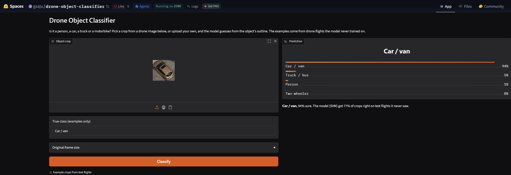
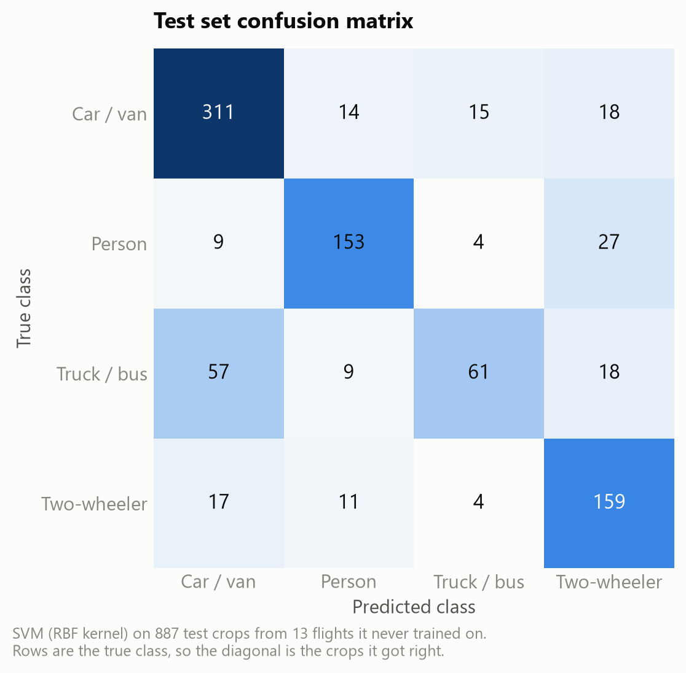
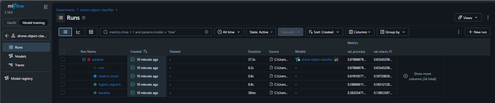
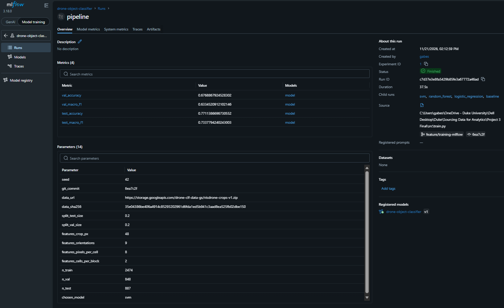
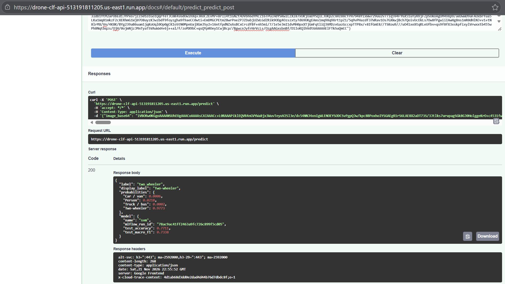

# Project-3-Final - Drone Object Classifier

Can the aerial object classifier from my last assignment go from scripts on my laptop to a live app anyone can use? This project takes the VisDrone
pipeline from [assignment 12](https://github.com/gsaju65/assignment-12), moves its data to Google Cloud Storage, tracks training with MLflow, packages the
model in Docker, serves it from Google Cloud Run and puts a Gradio front-end on Hugging Face Spaces.

**Front-end:** [huggingface.co/spaces/gsaju/drone-object-classifier](https://huggingface.co/spaces/gsaju/drone-object-classifier)
**Model API:** [drone-clf-api-513191811205.us-east1.run.app](https://drone-clf-api-513191811205.us-east1.run.app/docs) (`POST /predict`, interactive docs at `/docs`)



## Result in brief

You pick or upload a crop of one object from a drone image, the Space sends it to the API on Cloud Run, and the API sends back the class and the probability of each class. 
Both run on free tiers, so they sleep when nobody is using them, and the first prediction after a quiet period can take up to a minute.

The model is an SVM on HOG shape features. **Test accuracy = 77.1%** (macro F1 = 0.734) on 887 crops from 13 flights it never saw. Always guessing the most
common class gets 40.4%. It does well on cars, people and two-wheelers but finds only 42% of trucks and buses, and most of the trucks it misses (57 of 145)
it calls a car or van. Full output is in [`results/metrics.csv`](results/metrics.csv) and
[`results/classification_report.txt`](results/classification_report.txt).

## How it fits together

```
VisDrone raw images (local, one time)
  └─ src/prepare_data.py: clean, sample and crop 4,209 objects → visdrone-crops-v1.zip
       └─ Google Cloud Storage (public bucket, us-east1)
            └─ src/train.py: download + SHA256 check → HOG features → train / validation / test by flight → 4 models → MLflow
                 └─ models/model.joblib → Docker "serve" image → Artifact Registry → Cloud Run (POST /predict)
                      └─ Gradio app on Hugging Face Spaces → requests.post(API_URL + "/predict")
```

| Part | What I used |
|---|---|
| **Data storage** | Google Cloud Storage bucket in us-east1, one public 27 MB zip |
| **Pipeline settings** | [`config.yaml`](config.yaml): seed, data URL and SHA256, cleaning filters, HOG settings, split sizes, model settings, MLflow names |
| **Experiment tracking** | MLflow: one run per pipeline with a child run per model, with params, metrics, plots and the registered model |
| **Container** | One [`Dockerfile`](Dockerfile) with two targets: `full` (train, test or serve) and `serve` (slim API image, 177 MB compressed) |
| **API** | FastAPI on Google Cloud Run (us-east1, 1 vCPU, 1 GiB, 0 to 1 instances), image stored in Artifact Registry |
| **Front-end** | Gradio on Hugging Face Spaces (free ZeroGPU tier; the app itself never uses the GPU) |
| **Tests** | pytest, run by GitHub Actions on every pull request |

## Data

- **Source:** VisDrone2019-DET test-dev, Tianjin University ([VisDrone-Dataset](https://github.com/VisDrone/VisDrone-Dataset)), downloaded from the 
  Ultralytics mirror. 1,610 drone images from 61 flights, with a box and a category for every object.
- **Cleaning ([`src/prepare_data.py`](src/prepare_data.py), run once locally):** the same rules as assignment 12. I kept objects at least 20 px on each
  side and not heavily occluded, grouped vans with cars and trucks with buses, and left out tricycles. At most 40 objects of each class per flight, picked
  at random (seed 42), so a few long flights full of parked cars can't dominate. That gives 4,209 crops: 1,619 car/van, 968 two-wheeler, 959 person and 663 truck/bus.
- **In the cloud:** each crop is a PNG, listed in a `labels.csv` with its class, flight, box size and frame size. Both are zipped and uploaded to
  [`gs://drone-clf-data-gs/visdrone-crops-v1.zip`](https://storage.googleapis.com/drone-clf-data-gs/visdrone-crops-v1.zip). The pipeline downloads it
  from there ([`src/ingest.py`](src/ingest.py)) and checks its SHA256 against `config.yaml` before using it.
- **Not in this repo:** the raw images, the crops, the trained model and the MLflow runs. The scripts re-create them.

## Model and evaluation

| | |
|---|---|
| **Task** | Classify one cropped object: person, car/van, truck/bus or two-wheeler |
| **Features** | HOG of the crop at 48x48 grayscale, plus the box's log aspect ratio and log size relative to the frame: 902 numbers per crop. Training and the API use the same code ([`src/features.py`](src/features.py)). |
| **Models** | Baseline (always the most common class), logistic regression, random forest, SVM with an RBF kernel |
| **Split** | By flight: 13 flights (887 crops) for test, 10 of the other 48 (848 crops) for validation, 38 (2,474 crops) for training |
| **Model choice** | Highest validation accuracy. The winner is refit on train + validation and scored on the test flights once. |
| **Metric** | Accuracy, plus macro F1 because the classes are not the same size |

Splitting by flight matters. VisDrone images come in sequences from the same flight, so the same parked car shows up frame after frame. A random split would put near-copies of 
test objects into training and make the score look better than it is.

| Model | Validation accuracy | Validation macro F1 | Test accuracy | Test macro F1 |
|---|---|---|---|---|
| Baseline (most common class) | 0.383 | 0.139 | | |
| Logistic regression | 0.597 | 0.563 | | |
| Random forest | 0.619 | 0.507 | | |
| **SVM (RBF kernel)** | **0.677** | **0.633** | **0.771** | **0.734** |

| Class (SVM, test) | Precision | Recall | F1 | Test crops |
|---|---|---|---|---|
| Car / van | 0.789 | 0.869 | 0.827 | 358 |
| Person | 0.818 | 0.793 | 0.805 | 193 |
| Truck / bus | 0.726 | 0.421 | 0.533 | 145 |
| Two-wheeler | 0.716 | 0.832 | 0.770 | 191 |



The test score matches assignment 12. That's expected: the same seed and test share pick the same 13 test flights, and after the refit the SVM trains on the same 48 flights. 
What changed is how the SVM was chosen: on 10 held-out validation flights instead of by cross-validation.

## Experiment tracking

Every run of `src/train.py` logs to MLflow (experiment `drone-object-classifier`):

- a parent **pipeline** run with the config, the data URL and SHA256, the git commit, the split sizes, the chosen model's validation and test scores, the
  confusion matrix, the reports, and the model itself, registered as `drone-object-classifier`
- a child run for each of the four models with its settings and validation scores





The deployed model comes from MLflow run `78ac9ac41ff2463a9fc726c899f5cd05`, and every API response includes that run ID, so any prediction can be traced back to the run that made the model.

## API

`POST /predict` takes one object crop as base64 in JSON. The frame size is optional and defaults to 1,360 x 765, the most common VisDrone frame.

```json
{"image_base64": "<PNG or JPEG, base64>", "frame_width": 1360, "frame_height": 765}
```

It returns the class, the probability of each class and which model answered:

```json
{"label": "two_wheeler", "display_label": "Two-wheeler",
 "probabilities": {"Car / van": 0.0006, "Person": 0.0218, "Truck / bus": 0.0002, "Two-wheeler": 0.9773},
 "model": {"name": "svm", "mlflow_run_id": "78ac9ac41ff2463a9fc726c899f5cd05", "test_accuracy": 0.7711, "test_macro_f1": 0.7338}}
```

There's also `GET /health`. A bad image gets a 400 error and a missing field a 422. Images are classified in memory and never saved or logged.



## Repository structure

| Path | Contents |
|---|---|
| `config.yaml` | Every pipeline setting |
| `src/download_raw.py` | Downloads VisDrone2019-DET test-dev and checks its SHA256 (same script as Project 2) |
| `src/prepare_data.py` | Cleans the labels and saves every kept object as a PNG crop (run once, locally) |
| `src/ingest.py` | Pipeline step 1: downloads the crops from Cloud Storage and checks the SHA256 |
| `src/features.py` | HOG and shape features, used by training and the API |
| `src/train.py` | The pipeline: ingest, features, split, train, compare, evaluate, log to MLflow, save the model |
| `src/evaluate.py` | Test scores, per-class report and confusion matrix |
| `src/config.py` | Loads `config.yaml` |
| `api/main.py` | FastAPI app with `/health` and `/predict` |
| `scripts/make_request.py` | Turns an image into a `/predict` request body for curl |
| `tests/` | Feature and API tests. They use a small stand-in model, so they run without the real one. |
| `Dockerfile`, `docker/entrypoint.sh` | The `full` and `serve` images |
| `frontend/` | Gradio app, its requirements and 16 example crops. This folder is what runs on Hugging Face Spaces. |
| `docs/deploy.md` | Cloud Run deployment steps |
| `.github/workflows/ci.yml` | Runs the tests on every pull request |
| `results/`, `figures/` | Scores, per-class report, confusion matrix and screenshots |

## Reproduction

Requires Python 3.12. From the repository root:

```bash
python -m venv .venv
.venv\Scripts\activate          # macOS/Linux: source .venv/bin/activate
pip install -r requirements.txt
```

**Train the model** (downloads the data from Cloud Storage, about a minute):

```bash
python -m src.train
mlflow ui --backend-store-uri sqlite:///mlruns/mlflow.db
```

Open http://127.0.0.1:5000 and switch to **Model training** to see the runs.

**Re-create the cleaned data from the raw images** (only needed to change the cleaning rules):

```bash
python -m src.download_raw
python -m src.prepare_data
```

`prepare_data` prints a new SHA256. Upload the zip to your own bucket and put its URL and SHA256 in `config.yaml`.

**Run the API locally and test it** (uvicorn in one terminal, the rest in another):

```bash
uvicorn api.main:app --port 8080
python scripts/make_request.py frontend/examples/person_1.png --out request.json
curl -X POST http://127.0.0.1:8080/predict -H "Content-Type: application/json" -d @request.json
pytest -v
```

On Windows PowerShell use `curl.exe` and `-d "@request.json"`.

**Run the whole project in Docker:**

```bash
docker build -t drone-clf .
docker run --rm -v "$PWD/models_docker:/app/models" -v "$PWD/mlruns_docker:/app/mlruns" drone-clf train
docker run --rm drone-clf test
docker build --target serve -t drone-clf-api .
docker run --rm -p 8080:8080 drone-clf-api
```

On Windows PowerShell write the volumes as `"${PWD}\models_docker:/app/models"`. Training in Docker reproduced the same model (test accuracy 0.7711).
The `serve` image copies `models/` in, so train first.

**Deploy the API to Cloud Run:** see [`docs/deploy.md`](docs/deploy.md).

**Run the front-end locally:** `pip install gradio==6.32.0 requests`, then `python frontend/app.py`. It calls the live API unless you set `API_URL` to another address.

Runs used Python 3.12.10, scikit-learn 1.9.1, scikit-image 0.26.0, MLflow 3.18.0 and FastAPI 0.165.0.

## Cost

Everything runs on free tiers: Cloud Storage and Cloud Run in us-east1, Artifact Registry under its 0.5 GB of free storage, and a free Hugging Face Space.
Cloud Run scales to zero when nobody is using it and is capped at one instance, and a $1 budget alert would email me if anything started costing money. The
commands to shut it all down are at the end of [`docs/deploy.md`](docs/deploy.md).

## Design changes along the way

- **Validation flights instead of cross-validation.** Assignment 12 chose the model by 5-fold cross-validation. This project asks for a train / validation /
  test split, so 10 of the training flights became a validation set. Validation scores are lower than test scores, mostly because the models are trained on fewer flights at that point.
- **Crops in the cloud, not features.** I uploaded the cleaned crops instead of the HOG features, so the pipeline's feature step runs on the cloud data and the API uses the exact same feature code on new images.
- **Probabilities.** The SVM now has `probability=True`, so the front-end can show a bar for each class. The label still comes from `predict()`, the same rule the test scores were computed with.
- **Hugging Face hardware.** Free Gradio Spaces now run on ZeroGPU, which won't start unless the app has a GPU function. The app has one placeholder 
  `@spaces.GPU` function that is never called, so it starts without ever asking for a GPU.
- **OneDrive.** The training script clears and refills `frontend/examples/`. In a OneDrive folder the empty folder sometimes survived the clear, and the
  next step failed after the images were already gone. `mkdir(exist_ok=True)` fixed it.

## Limitations

- **Trucks.** It finds only 42% of trucks and buses. From straight above, a small truck has about the same outline as a van, and HOG only describes edges and shape, not color or texture.
- **Small validation and test sets.** 10 validation flights and 13 test flights. On a different set of flights the scores could easily be a few points higher or lower.
- **Design choices saw every flight.** The class groups, the per-flight cap and the SVM settings come from assignment 12, where I tried them across all 61 flights, so the test score may be slightly optimistic.
- **Uploaded images.** The model expects a tight box around one object, seen from VisDrone heights. A ground-level photo or a crop with lots of background
  will still get an answer, but it won't mean much. For uploads the frame size is a guess (1,360 x 765) unless you enter it.
- **Cold starts.** The Space and the API both sleep when idle. The first request after a quiet period can take up to a minute.
- **One part of VisDrone.** I used the 1,610-image test-dev set. The 6,500-image training set and pretrained CNN features (for example ResNet) would likely separate trucks from vans better.

## Ethics

- **Watching people from above.** Part of this model's job is spotting people in drone images. On its own it only labels a small crop and can't identify
  anyone, since it sees a 48x48 grayscale outline. But a classifier like this is one piece of a system that could count or follow people who don't know
  they're being filmed. It fits uses like search and rescue or traffic studies, not watching individuals.
- **Where the data comes from.** VisDrone was filmed in 14 cities in China. Streets, vehicles and camera heights elsewhere look different, so accuracy could
  be lower in other places, and the 77% shouldn't be assumed to carry over.
- **Mistakes aren't equal.** Missing 58% of trucks would matter if someone used this to count heavy traffic. The front-end shows every class's probability, not just the top one, so a user can see when the model isn't sure.
- **Uploads.** The API classifies images in memory and doesn't save or log them. Gradio keeps a temporary copy of an upload on the Space while it runs, so don't upload anything private.
- **Redistributing data.** The public bucket holds crops from a research dataset. I kept it to what's needed to reproduce this project and credit the dataset's authors below.

## References

Dalal, N., & Triggs, B. (2005). Histograms of oriented gradients for human detection. *IEEE Computer Society Conference on Computer Vision and Pattern Recognition (CVPR)*, 886-893.

Zhu, P., Wen, L., Du, D., Bian, X., Fan, H., Hu, Q., & Ling, H. (2022). Detection and tracking meet drones challenge. *IEEE Transactions on Pattern Analysis and Machine Intelligence, 44*(11), 7380-7399.